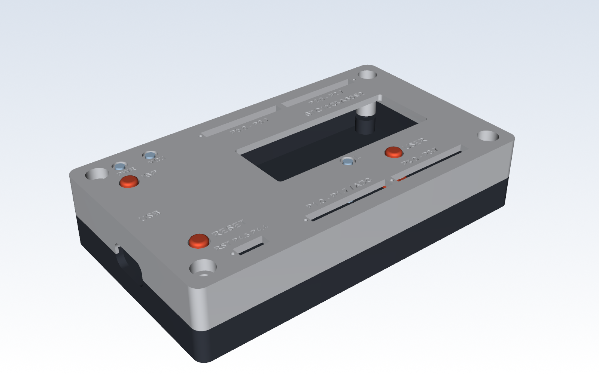
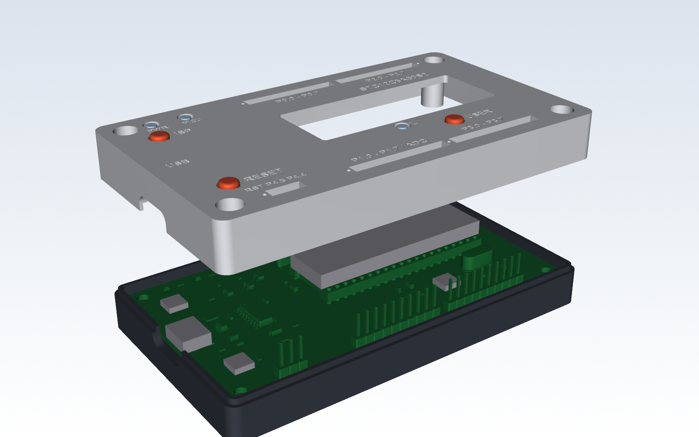

# Kutu (3D baskı)

STC12 kartı için iki parçalı kutu. Dış ölçü **105 x 61 x 21.6 mm**.



## Kutunun üzerinde ne var

| Ne | Nasıl |
|---|---|
| Port header'ları (P0–P3, RST/P4.5/P4.4) | Kapakta her header'ın üstünde bir yarık var. Dupont kablo uçları yarıktan geçip pinlere takılıyor. Yanlarında port adları ve 1. pin noktası kabartma değil, oyma olarak yazılı. |
| MCU soketi | Kapakta pencere açık. Çip, kutu açılmadan takılıp çıkarılabilir. |
| ISP, RESET, USER butonları | Kapaktaki deliklerden çıkan basma pimleri (kırmızı) butonlara basıyor. Her pimin altında kılavuz tüpü var, yakası pimin dışarı düşmesini engelliyor. |
| PWR, MCU, L LED'leri | Kapakta delik var. İçine şeffaf ışık boruları takılıyor. Borular olmadan da ışık görünür ama sönük kalır. |
| USB-C | Sol yan duvarda kablo ucunun kalıbının içeri girebileceği kadar geniş (13 x 7.4 mm) bir açıklık var. |



## Dosyalar

| Dosya | Adet | Baskı yönü |
|---|---|---|
| `kutu_alt.stl` | 1 | Taban tablaya. Destek gerekmez. |
| `kutu_ust.stl` | 1 | Dosyada ters çevrili, üst yüzü tablaya gelir. Destek gerekmez. Oyma yazılar tabla yüzünde kalır. |
| `pim_x3.stl` | 3 pim | Konik uç tablaya. Uç küçük olduğu için brim önerilir. |
| `isik_borusu_x3.stl` | 3 boru | Yaka tablaya. Şeffaf ya da natürel PETG/PLA ile basılmalı. |
| `kutu.step` | – | Montajlı hâl. Fusion, FreeCAD ya da Bambu Studio'da açılabilir. |
| `kutu.py` | – | Parametrik kaynak (CadQuery). Ölçüler dosyanın başında. |

**Baskı ayarları:** PLA ya da PETG, 0.2 mm katman, 3 duvar, %15 dolgu. Bambu Studio'da STL'leri doğrudan açabilirsiniz.

## Montaj

Gerekenler:
- 4 adet **M3x16 imbus vida** (DIN 912)
- İsteğe bağlı 4 adet 10 mm lastik ayak (tabanda 0.6 mm'lik yuvaları var)

Adımlar:
1. Kartı alt tablanın içindeki dört ayağın üstüne oturtun. USB-C, yan duvardaki açıklığa gelir.
2. Pimleri ve ışık borularını kapağın deliklerine içeriden takın. Kapak ters dururken bu daha kolaydır.
3. Kapağı kapatın. Alt tablanın kenarındaki dil, kapaktaki yuvaya oturur.
4. Vidaları kapağın köşelerinden takın. Vida önce kapağın kulesinden, sonra kartın deliğinden geçer, alt tablanın ayağına kendi yolunu açarak tutunur. Kart, kule ile ayak arasında sıkışır.
   - PLA'da vidayı fazla sıkmayın.
   - Sık sökülüp takılacaksa M3 sıcak gömme somun kullanın. Bunun için `kutu.py` içinde `KILAVUZ_D = 4.0` yapıp dosyaları yeniden üretin.

## Doğrulama

`kutu.py`, kartın KiCad'den dışa aktarılan 3D modeliyle her parçanın kesişim hacmini ölçüyor. Bu modelde:
- **Kartın kendi modelinden gelenler:** Header'lar, soket, kristal, SIP dizisi ve SMD parçalar.
- **Elle eklenen kutular:** KiCad'de 3D modeli olmayan USB-C ve butonlar, sokete takılı çip.

Sonuç: kart ile alt tabla, kapak, pimler ve ışık boruları arasında **çakışma 0 mm³**. Alt tabla ile kapak, ve kapak ile pimler/borular arasında da çakışma yok.

Kontrolün çakışma yakalayabildiği de denendi: kapak 3 mm aşağı indirildiğinde header'lar ve çiple 139.5 mm³ çakışma bulunuyor.

Kapağın alt yüzüyle en yüksek parça (header uçları) arasında 2.5 mm boşluk kalıyor.

**Denenmeyenler:** Kutu basılıp gerçek kartla denenmedi. Yazıcıdan yazıcıya ölçü sapması olabilir. Sıkı gelen yerler için `kutu.py`'deki toleranslar değiştirilebilir:
- `BOSLUK`: kart ile duvar arası
- `PIM_DELIK`: pim deliği çapı
- `DIL_B`: dil boşluğu

## Yeniden üretme

```bash
pip install cadquery
python kutu.py kart.step   # kart.step isteğe bağlı: çakışma kontrolü için
```

`kart.step` dosyası şu komutla elde edilir: `kicad-cli pcb export step --subst-models -o kart.step stc89_kart.kicad_pcb`. 3D modellerin bulunması için `KICAD9_3DMODEL_DIR` değişkeni tanımlı olmalı.
