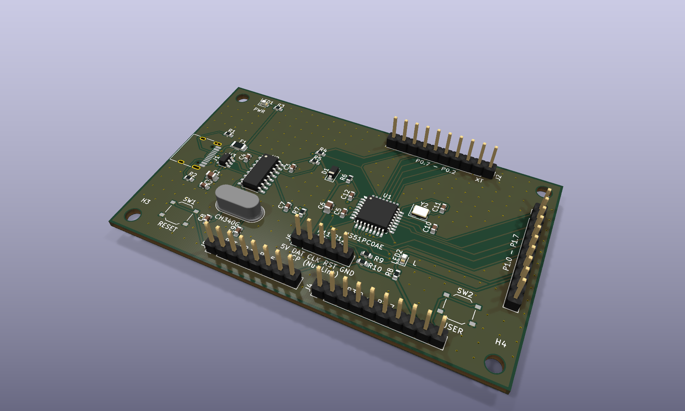

# MS51 geliştirme kartı (Rev C)

Nuvoton **MS51PC0AE** ile 8051 geliştirme kartı.
- **MCU:** 1T 8051, 32K flash, 2K XRAM, 12 bit ADC, 6 kanal PWM. Kartta 24 MHz kristal var (Rev C).
- **Kart:** 84 x 50 mm, 2 katman. USB-C ile beslenir ve programlanır.

STC12 kartından (`../donanim`) en önemli farkı şu: MS51 fabrikadan bootloader'sız gelir. Bootloader her çipe bir kez ICP header'ından (J6) Nu-Link ile yüklenir. Bundan sonra kart, STC kartı gibi USB üzerinden programlanır.



## STC12 kartıyla karşılaştırma

| | STC12 kartı | MS51 kartı |
|---|---|---|
| MCU | STC12C5A60S2, DIP-40, sokette | MS51PC0AE, LQFP-32, lehimli |
| ADC | 10 bit, 8 kanal | **12 bit, 15 kanal** |
| PWM | 2 kanal | 6 kanal (PWM0) + ek PWM birimleri |
| Bootloader | Fabrikada ROM'da | **Yok.** Bir kez ICP ile LDROM'a yüklenir |
| Bootloader'a giriş | MCU'nun gücü kesilip verilmeli (Q1–Q3 + ISP butonu) | Her reset'te çalışır. CH340'ın DTR'si reset atar |
| Kristal | 11.0592 MHz | 24 MHz (Y2, P0.0/P0.1) |
| P0 pull-up dizisi | Var (P0 açık-drain) | Yok (portlar push-pull/quasi ayarlanabilir) |
| Parça sayısı | 44 | 38 (CH340G seçeneğiyle 41) |
| Malzeme, kart başına (LCSC) | 4.34 $ | 2.81 $ (Rev B; Rev C'nin 8 yeni parçası eklenmedi) |
| Türkiye'de MCU | Yok | **Özdisan**: MS51PC0AE-TR, 40.05 TL + KDV, 16 bin adet stok |

## Devre

| Blok | Parçalar | Not |
|---|---|---|
| USB ve güç | J1, F1, U3, R1, R2, C1, C2, LED1 | STC kartıyla aynı. MCU doğrudan +5V ile çalışır (MS51: 2.4–5.5 V) |
| USB-UART | U2 (CH340C ya da CH340G), C3, C4; CH340G ise Y1, C8, C9 | CH340 TXD → **R4 (1k)** → P0.7/RXD. P0.6/TXD → **R5 (1k)** → CH340 RXD. P0.6/P0.7 header'a da çıktığı için seri dirençler var |
| Kristal | Y2, C10, C11 | 24 MHz (12 pF yüklü, ±10 ppm) XIN = P0.0 (pin 23), XOUT = P0.1 (pin 24). Yük kondansatörleri 18 pF: 2 × (12 − ~3 pF kaçak kapasite). Bu iki pin header'a çıkmaz |
| Reset | R6, C12, C7, R7, D1, SW1 | RST 10k ile +5V'a çekili, 100 nF (C12) ile GND'ye. DTR → 1 µF (C7) → 1k → RST: port açılınca kısa bir reset darbesi gider (Arduino'daki gibi); RST ≈ 0,45 V'a iner ve ≈ 11 ms'de geri kalkar. D1, darbe bitince RST'nin +5V'u aşmasını engeller. SW1 = RESET |
| ICP | J6, R9–R12 | Nu-Link bağlantısı, MCU'nun hemen altında. Sıra: **1 = +5V, 2 = DAT (P1.6), 3 = CLK (P0.2), 4 = RST, 5 = GND**. DAT ve CLK'ta MCU tarafında 100k pull-up (R9, R10), header tarafında 100 Ω seri direnç (R11, R12) |
| Kullanıcı | LED2 (P1.2, aktif düşük), SW2 (P3.0/INT0 → GND) | LED2, PWM0_CH0 pininde; parlaklık ayarı denenebilir |

### CH340C ya da CH340G (Rev B)

U2 yerine iki entegreden biri takılır. İkisinin bacak dizilimi aynı.

| | CH340C (varsayılan) | CH340G |
|---|---|---|
| Kristal | Gerekmez | 12 MHz kristal (Y1, HC-49S) ve 2 × 22 pF (C8, C9) takılır |
| Nereden | LCSC C84681, Türkiye'de yok | Türkiye'de stokta: [Özdisan](https://www.ozdisan.com/en/p/controllers-227/wch-ch340g-469466), ≈ 27 TL + KDV |
| Y1, C8, C9 | Boş kalır | Lehimlenir |

Kartta bu üç parçanın yeri U2'nin altında ve serigrafide "CH340G" yazıyor. Şemada ve PCB'de "takılmaz" (DNP) işaretli, bu yüzden JLCPCB dizgi dosyalarına girmezler. CH340G kullanılacaksa elle lehimlenirler: kristal delikli, kondansatörler 0603.

### Rev C değişiklikleri (inceleme sonrası)

Bir meslektaşın incelemesindeki öneriler uygulandı:

| Öneri | Uygulanan |
|---|---|
| MCU'nun 23 ve 24. pinlerine kristal ve iki kondansatör | 24 MHz kristal (Y2) ve 2 × 18 pF (C10, C11). Kristal varsayılan olarak takılı ve JLCPCB dizgisine dahil |
| ICP soketi MCU'ya yakın olsun | J6, kart kenarından MCU'nun hemen altına alındı. Kutudaki yarık da oraya taşındı |
| ICE_DAT ve ICE_CLK'a 100k pull-up | R9, R10 |
| ICE_DAT ve ICE_CLK'a 100 Ω seri (opsiyonel) | R11, R12, header tarafında |
| nRESET'e 10k pull-up | Zaten vardı (R6) |
| nRESET'e 10 µF | **100 nF konuldu (C12).** 10 µF, DTR'den gelen otomatik reset darbesini yutar; web yükleyici kartı kendisi resetleyemezdi. Darbenin RST'yi yine aşağı çekebilmesi için C7 100 nF'tan 1 µF'a çıkarıldı |

**Kristal ve yazılım:** MS51 her açılışta dahili osilatörle (HIRC) başlar; kristale geçişi yazılım yapar (CKEN.EXTEN = 01, HXTST bitini bekle, CKSWT.OSC = 10). Kristal takılı olsa da kullanıcı programı kendisi geçmedikçe çip dahili osilatörle çalışır. Bootloader şimdilik HIRC 24 MHz kullanıyor; 115200 baud hesabı 24 MHz'e göre yapıldığı için kristale geçince değişmesi gerekmez. Bootloader'ın kristale geçmesi ayrı bir iş.

**Not:** Datasheet HIRC'in fabrika ayarlı ve "tüm koşullarda ±%2" olduğunu söylüyor (MS51 32K TRM Rev 1.01, §6.2.1, s. 211); incelemedeki ±%10 bunun üstünde. Kristal yine de UART ve zamanlama doğruluğu için yerinde.

### Header'lar

| Header | Pinler (1 → son) |
|---|---|
| J2 · P0 | boş, boş, P0.2 … P0.7, +5V, GND (P0.0/P0.1 kristale ayrıldı; serigrafide "XT") |
| J3 · P1 | P1.0 … P1.7, +5V, GND |
| J4 · P3 | P3.0 … P3.7, +5V, GND |
| J5 · P2 | RST, P2.1 … P2.5, +5V, GND |

Ortak kullanılan pinler:
- **P0.6 / P0.7:** USB-UART hattı (TXD/RXD). Program çalışırken başka iş için kullanılabilir, ama yükleme sırasında üzerlerine bir şey bağlı olmamalı.
- **P0.2 / P1.6:** ICP hattı. Bootloader yüklenirken üzerlerine bir şey bağlı olmamalı.
- **P1.2:** Kullanıcı LED'i.
- **P3.0:** USER butonu.

**ADC kanalları:**

| Kanal | Pin | Kanal | Pin | Kanal | Pin |
|---|---|---|---|---|---|
| CH0 | P1.7 | CH5 | P0.4 | CH11 | P2.3 |
| CH1 | P3.0 | CH6 | P0.3 | CH12 | P2.4 |
| CH2 | P0.7 | CH7 | P1.1 | CH13 | P1.3 |
| CH3 | P0.6 | CH9 | P2.1 | CH14 | P1.4 |
| CH4 | P0.5 | CH10 | P2.2 | CH15 | P2.5 |

Pin dizilimi kaynağı: Nuvoton *MS51 Series Product Brief* Rev 2.00, Şekil 5-1 (LQFP-32). Ayrıntılı pin görevleri için Nuvoton'un MS51 32KB datasheet'ine bakın.

## Bootloader yükleme (her çip için bir kez)

Bootloader `bootloader/` klasöründe: `ms51_isp.bin`, 1 630 bayt. Yükleme adımlarının ayrıntısı `bootloader/BENIOKU.md` dosyasında.

1. Kartı USB'den çıkarın. Nu-Link'i J6'ya bağlayın; pin sırası yukarıdaki tabloda. Nu-Link'in kablo ucundaki sırayı kendi kılavuzundan kontrol edin.
2. Nuvoton'un *NuMicro ICP Programming Tool* programıyla `bootloader/ms51_isp.bin` dosyasını LDROM'a yazın.
3. CONFIG ayarları:
   - **Boot select: LDROM:** Çip her reset'te bootloader'dan başlar.
   - **LDROM size: 2 KB:** APROM 30 KB olur.
   - **Reset pini etkin kalmalı:** P2.0'ın reset görevi kapatılmamalı.

Bundan sonra kart USB-C ile takılıp web yükleyicide "Nuvoton MS51" seçilerek programlanır (`../yukleyici/nuvoton.js`). Bootloader her reset'ten sonra 500 ms bağlantı bekler, gelmezse kullanıcı programını (APROM) başlatır.

## Dosyalar

| Dosya | Ne |
|---|---|
| `kicad/ms51_kart.kicad_pro` | KiCad projesi. Rev C, **KiCad 10** ile üretildi; KiCad 9 açamaz |
| `kicad/ms51_kart.kicad_sch`, `.pdf` | Şema |
| `kicad/ms51_kart.kicad_pcb` | PCB: yollar çizildi, iki katmanda GND dökümü var |
| `kicad/ms51.kicad_sym`, `sym-lib-table` | MS51PC0AE sembolü. KiCad'in kendi kütüphanesinde Nuvoton yok |
| `kicad/pcb_3d_*.png`, `pcb_onizleme.svg` | Görüntüler |
| `kicad/ms51_kart-easyeda.zip` | EasyEDA Pro'ya aktarmak için |
| `uretim/` | JLCPCB sipariş dosyaları (Gerber, BOM, CPL); bkz. `uretim/BENIOKU.md` |
| `kutu/` | 3D baskı kutusu (CadQuery): STL, STEP ve kaynak; bkz. `kutu/BENIOKU.md` |
| `bootloader/` | LDROM bootloader'ı: kaynak, derlenmiş `ms51_isp.bin` ve testler; bkz. `bootloader/BENIOKU.md` |
| `BOM.csv` | Malzeme listesi (LCSC kodlarıyla) |
| `kicad/kart_tanim.py` | **Tek kaynak:** parçalar, pin-net eşleşmesi, MS51 pin tablosu |
| `kicad/ms51_sembol.py`, `kicad_uret.py`, `pcb_uret.py`, `yol_uret.py`, `uretim.py`, `dogrula.py` | Üretici ve doğrulama betikleri; STC kartındakilerin uyarlaması |

## Doğrulama (KiCad 10.0.8)

- **ERC:** 0 hata, 0 uyarı.
- **Netlist:** KiCad'in netlist'i `kart_tanim.py` ile birebir aynı: 48 net, 170 bağlantı.
- **DRC:** 0 ihlal, 0 bağlanmamış nokta, şemayla 0 eşleşme hatası.
- **Yollar:**
  - Freerouting 1.9.0 ile çizildi: 518 yol parçası ve 31 via.
  - Sinyal yolları 0.25 mm, +5V ve VBUS 0.4 mm. Aralık en az 0.2 mm.
  - Yönlendirme sırasında kart kenarlarında 0.8 mm'lik via ve yol yasağı kullanıldı (Freerouting kenar payını bilmiyor).
  - USB-C'nin iki yüzündeki D+/D- pad'lerini birleştiren köprüler (A6-B6, A7-B7) `yol_uret.py` tarafından önceden çiziliyor; Freerouting KiCad 10 kütüphanesiyle A6'yı bağlayamadı.
  - 215 GND dikiş viası eklendi. Parçaların altına konmadı; iki katmana birden bağlanamayanlar silindi.

**Doğrulanmayanlar:**
- **Donanım:** Kart üretilmedi, gerçek donanımda denenmedi.
- **Reset ile ICP etkileşimi:** Rev C'de RST'de 100 nF (C12) ve DTR kuplajı 1 µF (C7) var. Nu-Link RST'yi bu yükle sürebilmeli, ama denenmedi. Sorun çıkarsa programlarken R7 sökülebilir.
- **Kristal:** 24 MHz kristalin bu yük kondansatörleriyle başladığı ve HXT kazanç ayarı (XTLCON.HXSG) gerçek kartta denenmedi. Kristalin datasheet'indeki pad dizilimi (1-3 kristal, 2-4 kılıf) kontrol edilmedi; YXC 3225 kristallerinin olağan dizilimi varsayıldı.
- **Rev C parçalarının LCSC stok ve fiyatı** okunamadı (C70590, C1647, C25803, C22775, C15849); sipariş öncesi bakın.
- **Bootloader ve web yükleyici:** Yazıldı ve SDCC ile derlendi (`bootloader/`, `../yukleyici/nuvoton.js`). Protokol kodu, bilgisayarda yükleyiciye karşı uçtan uca test edildi; 11 test geçti. MS51'e özel donanım kodu (`hal_ms51.c`) gerçek çipte henüz çalıştırılmadı.

## Maliyet ve tedarik

- **Malzeme:** LCSC'de kart başına **2.81 $** (≈ 142 TL). Minimum alım adetleriyle tek kartlık sepet 9.92 $. Fiyatlar 17 Kasım 2026'da alındı.
- **MS51PC0AE:** LCSC C2688383, 1.33 $, stok 2 242. Türkiye'de [Özdisan](https://www.ozdisan.com/p/mikroislemciler-218/nuvoton-ms51pc0ae-tr-652409), 40.05 TL + KDV.
- **Nu-Link:** [Özdisan](https://www.ozdisan.com/p/islemci-programlayicilari-610/nuvoton-nu-link-531781), 1 545 TL + KDV. Uyumlu kopyası [motorobit](https://www.motorobit.com/nu-link-plus-icp-programlayici-nuvoton-uyumlu)'te 1 669 TL KDV dahil. Bir laboratuvara bir tane yeter.
- **LCSC'de stokta olmayanlar (17 Kasım):** 100 nF (C14663), 1k (C21190) ve yeşil LED (C72043). Aynı kılıfta herhangi bir muadili kullanılabilir.
- **Diğer parçalar:** STC kartıyla aynı. Türkiye'deki kaynakları için `../donanim/tedarik.md` dosyasına bakın.

## Yeniden üretme

macOS'ta kurulu KiCad 10 ile, Docker olmadan:

```bash
cd kicad
K=/Applications/KiCad/KiCad.app/Contents
PY=$K/Frameworks/Python.framework/Versions/3.9/bin/python3
export PATH=$K/MacOS:$PATH
$PY ms51_sembol.py && $PY kicad_uret.py $K/SharedSupport/symbols
kicad-cli sch erc -o erc.rpt ms51_kart.kicad_sch
kicad-cli sch export netlist -o out.net ms51_kart.kicad_sch && $PY dogrula.py
$PY pcb_uret.py $K/SharedSupport/footprints out.net && $PY yol_uret.py dsn
java -jar freerouting-1.9.0.jar -da -dct 0 -de ms51_kart.dsn -do ms51_kart.ses -mp 100 -mt 1
$PY yol_uret.py ses && kicad-cli pcb drc --schematic-parity --severity-all -o drc.rpt ms51_kart.kicad_pcb
$PY uretim.py
```

Betikler KiCad 9 ile de çalışır (`/usr/share/kicad/...` yollarıyla); KiCad 9'da USB-C kalkan pini `S1` adındaydı, `kart_tanim.py`'de `SH` yazıyor.

Dikkat: `pcb_uret.py` ve `yol_uret.py` PCB'yi baştan yazar. KiCad'de elle değişiklik yaptıktan sonra çalıştırmayın.
