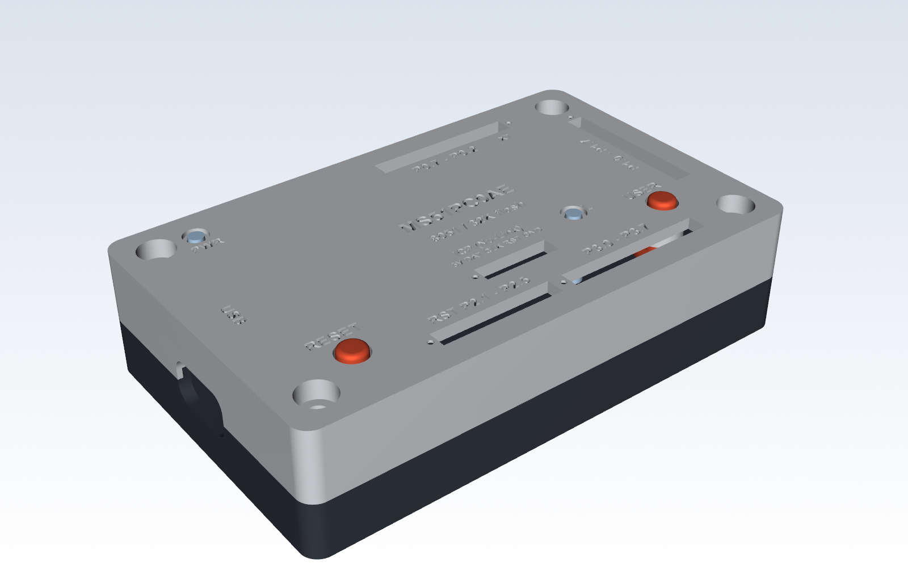
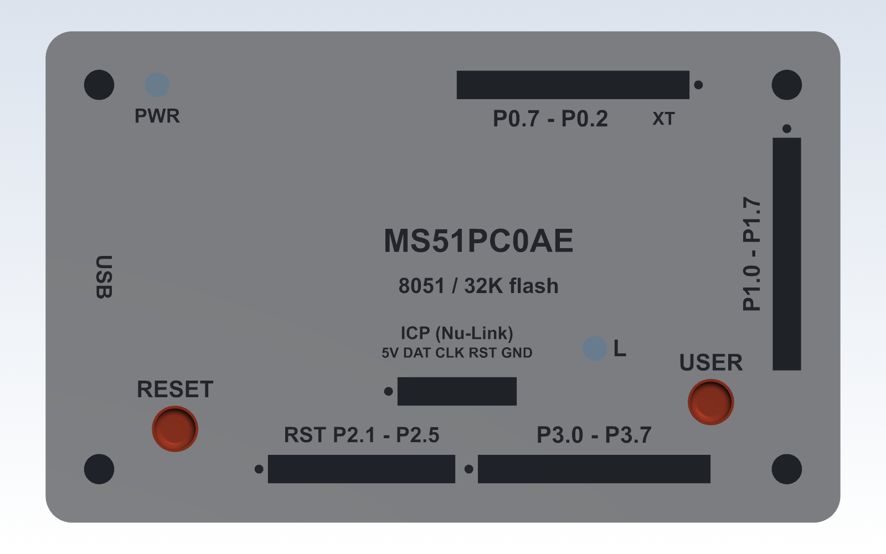
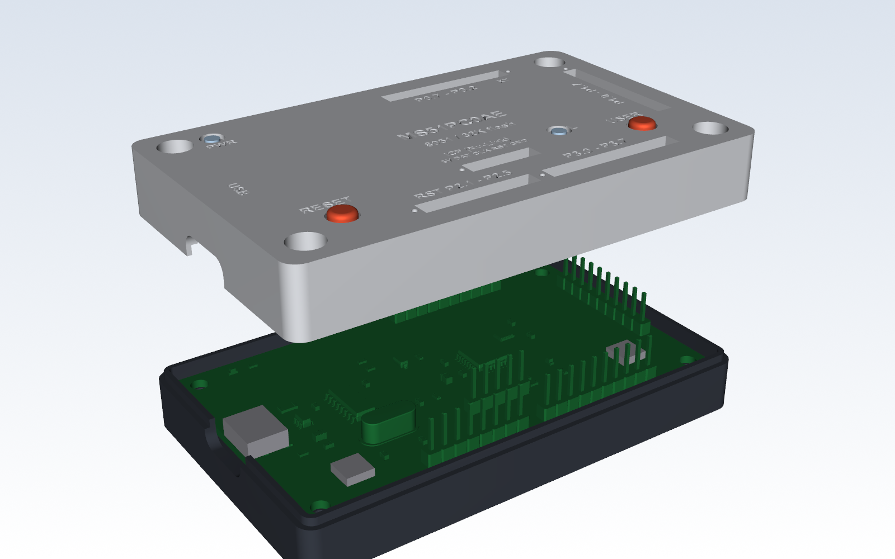

# Kutu (3D baskı)

MS51 kartı için iki parçalı kutu. Dış ölçü **89 x 55 x 21.6 mm**.

STC12 kutusunun (`../../donanim/kutu`) uyarlamasıdır. Yapısı, montajı ve toleransları aynı; kartın ölçüleri ve parça yerleri değişti.





## Kutunun üzerinde ne var

| Ne | Nasıl |
|---|---|
| Port header'ları: P0, P1, P2, P3 | Kapakta her header'ın üstünde bir yarık var. Dupont kablo uçları yarıktan geçip pinlere takılıyor. Port adları ve 1. pin noktası oyma olarak yazılı. |
| ICP header'ı (J6) | Bu da yarık; Rev C'de MCU'nun altında, kapağın ortasında. Nu-Link kablosu kutu açılmadan takılabiliyor. Pin sırası kapakta yazılı: 5V DAT CLK RST GND. |
| RESET, USER butonları | Kapaktaki deliklerden çıkan basma pimleriyle (kırmızı) basılıyor. Her pimin altında kılavuz tüpü var, yakası pimin dışarı düşmesini engelliyor. |
| PWR, L LED'leri | Kapakta delik var, içine şeffaf ışık boruları takılıyor. |
| USB-C | Sol yan duvarda 13 x 7.4 mm açıklık var. Kablo ucunun kalıbı içeri girebiliyor. |

STC kutusundan farkları:
- Soket penceresi yok, çünkü MS51 karta lehimli.
- Buton ve LED sayısı üç yerine iki.
- P1 header'ının yarığı sağ kenarda ve dikey.



## Dosyalar

| Dosya | Adet | Baskı yönü |
|---|---|---|
| `kutu_alt.stl` | 1 | Taban tablaya. Destek gerekmez. |
| `kutu_ust.stl` | 1 | Dosyada ters çevrili, üst yüzü tablaya gelir. Destek gerekmez. |
| `pim_x2.stl` | 2 pim | Konik uç tablaya. Uç küçük olduğu için brim önerilir. |
| `isik_borusu_x2.stl` | 2 boru | Yaka tablaya. Şeffaf ya da natürel PETG/PLA ile basılmalı. |
| `kutu.step` | – | Montajlı hâl. FreeCAD, Fusion ya da Bambu Studio'da açılabilir. |
| `kutu.py` | – | Parametrik kaynak (CadQuery). Ölçüler ve parça konumları dosyanın başında. |

**Baskı ayarları:** PLA ya da PETG, 0.2 mm katman, 3 duvar, %15 dolgu. STL'ler Bambu Studio'da doğrudan açılır. Dört dosya tek tablaya sığar.

## Montaj

Gerekenler:
- 4 adet **M3x16 imbus vida** (DIN 912)
- İsteğe bağlı 4 adet 10 mm lastik ayak. Tabanda 0.6 mm derinliğinde yuvaları var.

Adımlar:
1. Kartı alt tablanın içindeki dört ayağın üstüne oturtun. USB-C yan duvardaki açıklığa gelir.
2. Kapak ters dururken pimleri ve ışık borularını kapağın deliklerine içeriden takın.
3. Kapağı kapatın. Alt tablanın kenarındaki dil, kapaktaki yuvaya oturur.
4. Vidaları kapağın köşelerinden takın. Vida kapağın kulesinden ve kartın deliğinden geçip alt tablanın ayağına kendi yolunu açarak tutunur. Kart, kule ile ayak arasında sıkışır.
   - Sık sökülüp takılacaksa M3 sıcak gömme somun kullanın. Bunun için `kutu.py` içinde `KILAVUZ_D = 4.0` yapıp dosyaları yeniden üretin.

## Yeniden üretme

```bash
pip install cadquery
python kutu.py                # STL ve STEP dosyaları
python kutu.py kart.step      # ayrıca kartla çakışma kontrolü
```

`kart.step`, KiCad'den dışa aktarılır:

```bash
kicad-cli pcb export step --subst-models -o kart.step ../kicad/ms51_kart.kicad_pcb
```

Kartta bir parçanın yeri değişirse `kutu.py`'nin başındaki `BUTONLAR`, `LEDLER`, `HEADERLAR` ve `YAZILAR` tabloları güncellenmelidir. Bu tablolardaki konumlar KiCad'deki gibi verilir: kartın sol üst köşesi (0, 0), y ekseni aşağı doğru.

## Doğrulama

`kutu.py`, kartın KiCad'den dışa aktarılan 3D modeliyle her kutu parçasının kesişim hacmini ölçüyor. KiCad'de 3D modeli olmayan USB-C ve iki buton için elle kutu şekilleri eklendi.

| Kontrol | Sonuç |
|---|---|
| Kart ile alt tabla, kapak, pimler ve ışık boruları | **0 mm³** çakışma |
| Alt tabla ile kapak; kapak ile pimler ve borular | **0 mm³** çakışma |
| Kontrol denemesi: kapak 3 mm aşağı indirildiğinde | 139.5 mm³ (header'lara giriyor; yani kontrol çakışmayı yakalayabiliyor) |
| En yüksek parça (header uçları) ile kapağın alt yüzü arası | 2.46 mm boşluk |
| CadQuery katı geçerliliği | Dört parça da geçerli ve tek gövde |

**Denenmeyenler:** Kutu basılıp gerçek kartla denenmedi. Ölçüler yazıcıdan yazıcıya biraz sapabilir. Sıkı gelen yerler için `kutu.py`'de şu toleranslar değiştirilebilir:
- `BOSLUK`: kart ile duvar arası
- `PIM_DELIK`: pim deliği çapı
- `DIL_B`: alt tabla dili ile kapak yuvası arası
